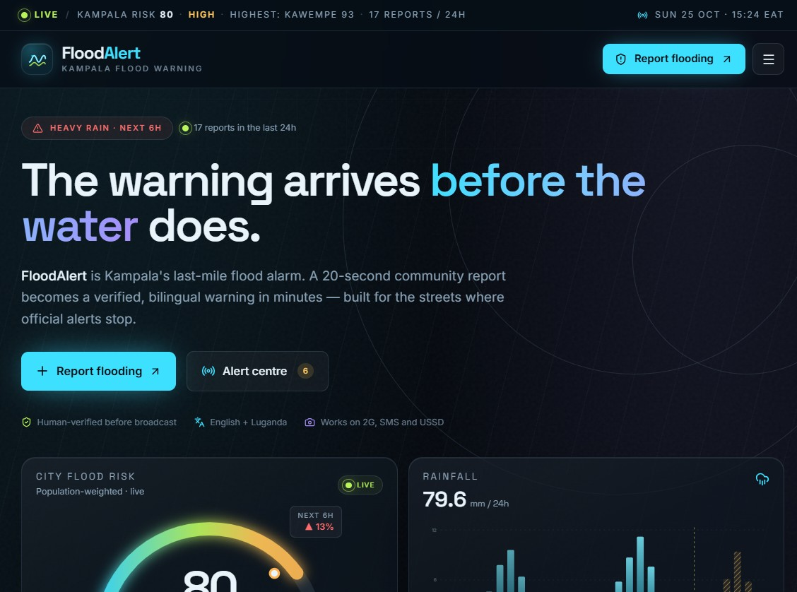
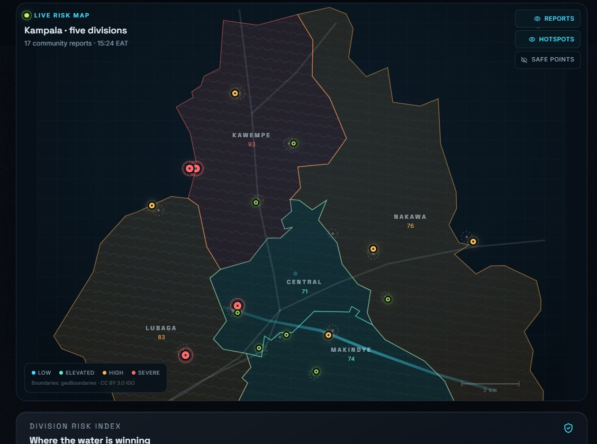
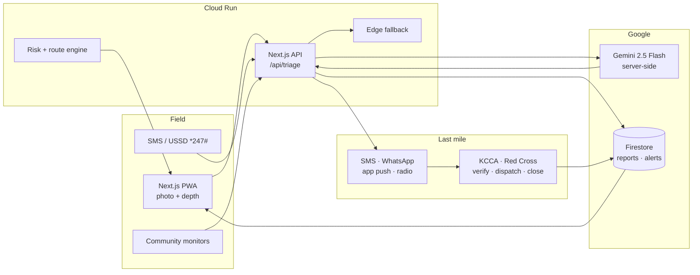

# FloodAlert

**The warning arrives before the water does.**

**FloodAlert** is a community-powered flood early-warning prototype for Kampala, Uganda. A resident sends a 20-second report — photo, landmark, water depth — Gemini triages it, a human verifies, and a bilingual SMS/radio/app alert reaches the circles most at risk.

Built for the **Pre-DevFest Hackathon 2026** against **SDG 11.5** (disaster losses), **13.1** (climate resilience), **3.9** (waterborne disease) and **17.17** (partnerships).

<p>
  
  
  
  
  
</p>

> **Demo honesty:** reports, alerts, subscriber circles and impact figures are seeded or modelled for the hackathon. They are not real KCCA records. Photos are openly licensed illustrations, not evidence for specific reports. The app labels this in the UI.



*The live demo dashboard: city risk, rainfall and the 20-second report CTA. Seeded Kampala scenario.*

---

## The problem

Kampala floods every rainy season. The people who see the water first — market vendors, boda riders, teachers, community volunteers — have no fast channel to warn the next street. Official alerts are city-wide, often English-first, and arrive by radio after the water has already reached the boda stage.

The last mile is not a data problem. It is a **delivery and trust problem**.

**The user:** Amina, a market vendor in Kisenyi. She shares a feature phone, needs Luganda, and has about 20 minutes between the first surge and water entering her stall.

## What works in this build

- **Live command dashboard** — five real Kampala division boundaries, 16 flood hotspots, risk choropleth, live reports, rainfall, division risk index.
- **Report wizard** — location, depth, hazards, photo; browser-side image resize; works offline; saves locally.
- **Gemini triage** — server-side multimodal analysis, strict JSON schema, English + Luganda alert drafts, escalation rules.
- **Deterministic edge fallback** — the same flow works with no API key, no network, or a Gemini timeout. The UI says which engine answered.
- **Human verification** — unverified queue, verify/dispatch/resolve state changes, and a human-in-the-loop broadcast step.
- **Alert composer** — target divisions, severity, channels, reach estimate, SMS cost estimate, EN/LG preview, simulated delivery receipt.
- **Risk-aware route check** — Dijkstra over a 16-node Kampala road graph, with flood penalties and a "no low-risk route" warning.
- **Optional Firestore sync** — anonymous auth, realtime snapshots, persistent local cache; the local demo store is used when Firebase is not configured.
- **PWA/offline shell** — service worker caches pages and demo assets in production; a connection banner explains offline behaviour.



*Live risk map, division scores and 17 community reports. Seeded Kampala scenario.*

## Quick start

```bash
npm install
cp .env.example .env.local   # optional: add GEMINI_API_KEY / Firebase config
npm run dev
```

Open <http://localhost:3000>. No account, API key or database is required for the demo.

```bash
npm test          # 25 unit tests (triage, risk, routing, seed)
npm run build     # production build
npm start         # serve the production build
```

### Optional: real Gemini triage

Add a server-only key to `.env.local`:

```dotenv
GEMINI_API_KEY=your_key_here
GEMINI_MODEL=gemini-2.5-flash
```

The key never reaches the browser. The route is `POST /api/triage`; it rate-limits to 20 requests/minute/IP, validates input with Zod, enforces a 16-second timeout, validates Gemini's JSON response, and falls back to the edge model on any failure. Without a key, the UI shows the edge fallback reason.

### Optional: Firestore

1. Create a Firebase project and enable **Anonymous Auth** and **Firestore**.
2. Fill the `NEXT_PUBLIC_FIREBASE_*` values in `.env.local`.
3. Deploy the rules:

   ```bash
   npx firebase-tools deploy --only firestore:rules
   ```

With config present, the app signs in anonymously, subscribes to `reports` and `alerts`, and writes through to Firestore. Without it, everything stays in `localStorage` and the nav shows **Demo data**.

## Google tools, used meaningfully

| Tool | Where | What it does |
| --- | --- | --- |
| **Gemini 2.5 Flash** | `src/lib/gemini.ts`, `/api/triage` | Multimodal photo + text triage, strict schema output, bilingual SMS drafts, escalation. Server-only key, timeout and fallback. |
| **Firebase Firestore** | `src/lib/cloud.ts` | Anonymous auth, realtime report/alert snapshots, persistent multi-tab local cache, best-effort writes. Rules in `firestore.rules`. |
| **Google Cloud Run** | `Dockerfile`, `cloudbuild.yaml` | Standalone Next.js container, scale-to-zero, Secret Manager for the Gemini key. |
| **Google Maps** | Report drawer | Deep links from a report's coordinates to Google Maps for field verification and directions. |

No tool is a logo on a slide: each one is wired into the demo or the deployment path, and the app degrades gracefully when Gemini or Firebase is absent.

## Architecture



### The loop

1. **Report** — a resident or monitor submits a photo, landmark, depth and hazards. Images are resized in the browser before upload.
2. **Triage** — `/api/triage` asks Gemini for schema-checked severity, confidence, hazards, actions, English alert and Luganda alert. A deterministic engine answers if Gemini is unavailable.
3. **Verify** — the report appears in the live map and the verification queue. Critical reports carry an explicit escalation flag and a call-999 message.
4. **Broadcast** — a human approves an alert to subscriber circles across SMS, WhatsApp, app push and radio. Reach and SMS cost are estimated before sending.
5. **Respond** — KCCA/Red Cross move the report through verified → responding → resolved. The loop is visible on the dashboard and in impact metrics.

### Data model

```ts
FloodReport {
  id, area, division, landmark, lat, lng,
  depthCm, hazards[], description, photo?,
  severity, confidence, source, status, reporter,
  createdAt, updatedAt,
  ai { engine, model, headline, summary, hazards[], actions[],
       alertEn, alertLg, escalate, latencyMs }
}

AlertRecord {
  id, division, area?, severity, title,
  messageEn, messageLg, channels[], reach,
  sentAt, status, reportId?
}
```

The demo state is one versioned `localStorage` key (`floodalert.state.v2`). Firestore documents use the same IDs and shape, so the two stores can merge by ID.

### Risk model

The division score is deliberately transparent, not a black box:

```
score = 35% × 24h rainfall
      + 30% × weighted report pressure
      + 20% × structural vulnerability
      + 15% × drainage deficit
```

Reports are weighted by severity and recency (0–3h, 3–6h, 6–12h, 12–24h). `Severe` starts at 88, `High` at 76, `Elevated` at 64. The same score feeds the map colour, division list and route penalties. Every input is visible in the UI or the source.

### Route check

A 16-node graph with 24 road edges. Each edge gets a flood penalty from its endpoint risks; the safest path minimises `minutes + penalty`, while the shortest path minimises minutes. If the recommended route is still High/Severe, the UI says so instead of pretending a safe route exists.

## Security & privacy

- Gemini key is server-only; never exposed via `NEXT_PUBLIC_`.
- API input is validated with Zod; image payloads are size-capped.
- In-memory rate limit (20/min/IP) is demo-grade. Production should use Firestore/Redis or Cloud Armor.
- Firestore rules require anonymous auth. Production should restrict alert creation and status updates to a responder custom claim.
- Reporter name is optional. Photos are stored with the report. Production adds face blurring, retention limits and role-based access.
- No auto-dispatch. The product does not claim to replace 999 or KCCA.
- Demo photos are CC BY-SA 4.0 and credited in-app and in [`public/demo/ATTRIBUTION.md`](public/demo/ATTRIBUTION.md).

`npm audit` reports high-severity advisories in Firebase's `@grpc/grpc-js` (the browser Firestore bundle uses WebChannel, not the Node gRPC transport) and in `pptxgenjs`'s `image-size` dev dependency (used only to generate the deliverables, not shipped in the app). Track the upstream fixes or override the dependencies when updates land.

## Testing

```bash
npm test
```

25 tests cover:

- severity thresholds and escalation keywords
- hazard normalisation and bilingual alert templates
- risk score bounds, levels, metrics and medians
- route connectivity, repeated nodes and same-origin handling
- seed uniqueness, timestamps, links and map bounds

`npx tsc --noEmit` and `npm run build` are clean.

## Deploy to Cloud Run

```bash
# Build and push
gcloud builds submit --tag gcr.io/PROJECT_ID/floodalert

# Store the Gemini key as a secret
printf 'YOUR_KEY' | gcloud secrets create gemini-api-key --data-file=-

# Deploy
gcloud run deploy floodalert \
  --image gcr.io/PROJECT_ID/floodalert \
  --region europe-west1 \
  --allow-unauthenticated \
  --port 3000 \
  --set-secrets GEMINI_API_KEY=gemini-api-key:latest \
  --set-env-vars NEXT_PUBLIC_SITE_URL=https://YOUR_URL
```

Or use the Dockerfile directly:

```bash
docker build -t floodalert .
docker run -p 3000:3000 -e GEMINI_API_KEY=... floodalert
```

`NEXT_PUBLIC_*` values are baked at build time. Pass them as Docker build args when enabling Firebase. `cloudbuild.yaml` is a starting point; update the substitution URL and region.

## Cost

Modelled at **4,000 reports and 40,000 SMS segments per month**:

| Item | Monthly |
| --- | ---: |
| Gemini 2.5 Flash | $2 |
| Cloud Run | $12 |
| Firestore + Storage | $5 |
| SMS (UGX 32 / segment) | $337 |
| Monitoring | $0 |
| **Total** | **≈ $356** |

That is **≈ $0.089 per report**. SMS is ~95% of the bill; with a sponsored shortcode, infrastructure + AI are under **$20/month**. Residents never pay for a warning.

## Limitations

- The dashboard is a **seeded demo**, not live KCCA data. Impact figures are modelled.
- SMS delivery, radio scripts and responder dispatch are simulated; no gateway is connected.
- The risk model is a transparent heuristic; it needs calibration against rain gauges and verified historic flood extents.
- Luganda drafts are generated templates/Gemini output and need native-speaker review before public broadcast.
- Firestore writes are best-effort in the demo; production needs App Check, a responder role and a queue for alert fan-out.
- Full offline navigation depends on the service worker after a first successful visit; the form itself degrades to local storage + edge triage.

## Pitch

The app is deliberately product-only. The 3-minute pitch deck, one-pager and script are maintained locally and are **not part of this public repository**. The live 20-second report demo is at `/report`.

**The ask:** a 90-day pilot in Bwaise and Kisenyi with KCCA, Uganda Red Cross and two Luganda radio partners. $15,000 for 50 community monitors, three months of SMS/radio and independent M&E.

## Credits

- Division boundaries: [geoBoundaries](https://www.geoboundaries.org/) UGA ADM4, CC BY 3.0 IGO.
- Demo photography: Wikimedia Commons, CC BY-SA 4.0. Full list in [`public/demo/ATTRIBUTION.md`](public/demo/ATTRIBUTION.md) and `/credits`.
- Icons: [Lucide](https://lucide.dev/), ISC.
- Fonts: Inter and Space Grotesk, SIL OFL.
- Built with Next.js, React, Tailwind CSS, Gemini, Firebase and Cloud Run.

FloodAlert is an independent hackathon prototype. It is not affiliated with or endorsed by KCCA, the Uganda Red Cross Society, the United Nations, Google or Wikimedia.

**Emergency: 999 / 112 · KCCA 0800 990 000 · Uganda Red Cross 0800 211 088.**
